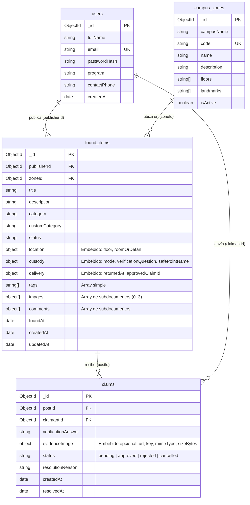

# Plan Técnico del MVP — Encuentra Campus

> **Referencias:** [constitution.md](../../docs/constitution.md) · [spec.md](./spec.md)  
> **Principio rector:** Next.js 16+ (App Router + Turbopack) como BFF, driver oficial `mongodb` contra MongoDB Atlas, bucket compatible con S3 (AWS S3 / Cloudflare R2) para imágenes, identificadores y campos de BD en inglés, UI y mensajes en español.

---

## 1. Arquitectura general y dependencias

### Flujo de capas (Separación de responsabilidades)
```
Cliente (React / App Router UI)
   │  HTTP JSON / multipart-form-data (sin credenciales ni acceso a BD)
   ▼
BFF — Route Handlers (`src/app/api/**`)         ← Valida entrada (Zod), sesión (cookie HttpOnly) y mapea errores HTTP
   ▼
Servicios de dominio (`src/services/**`)        ← Reglas de negocio, permisos, transiciones de estado e integridad
   ▼
Repositorios (`src/repositories/**`) + Storage  ← Consultas CRUD, Aggregation Framework (MongoDB) y S3/R2
   ▼
MongoDB Atlas (`$jsonSchema` + índices) & Bucket S3/R2 (credenciales solo en `.env.local`)
```

### Dependencias declaradas (Constitución #1)
| Paquete | Propósito | RF cubiertos |
| --- | --- | --- |
| `next` (16+, Turbopack), `react`, `react-dom` | Framework full-stack App Router + BFF. | Todos (`RF-01`–`RF-09`) |
| `mongodb` | Driver oficial de MongoDB (CRUD nativo, `$set`/`$push`/`$pull`, Aggregation Framework, `$jsonSchema`). | Todos (`RF-01`–`RF-09`) |
| `@aws-sdk/client-s3` | Cliente estándar S3 compatible con AWS S3 y Cloudflare R2 para subir y eliminar imágenes. | `RF-02`, `RF-04`, `RF-05`, `RF-07` |
| `zod` | Validación tipada de payloads de entrada y formularios en el BFF con mensajes en español. | Todos (`RF-01`–`RF-09`) |
| `bcryptjs` | Hash seguro de contraseñas (nunca en texto plano). | `RF-01` (RNF-03) |
| `jose` | Firma y verificación de JWT en cookie `HttpOnly` para sesiones básicas. | `RF-01`, `RF-02`, `RF-04`–`RF-08` |
| `tailwindcss` | Estilos responsivos sin librerías pesadas de UI. | RNF-01, RNF-06 |

### Variables de entorno requeridas (`.env.local`, plantilla en `.env.example`)
- `MONGODB_URI`, `MONGODB_DB_NAME`
- `JWT_SECRET`
- `S3_ENDPOINT`, `S3_REGION`, `S3_BUCKET`, `S3_ACCESS_KEY_ID`, `S3_SECRET_ACCESS_KEY`, `S3_PUBLIC_BASE_URL`

---

## 2. Estructura de carpetas y módulos (con trazabilidad de RF)

El código de la aplicación vivirá dentro de `code/` (donde ya reside `code/AGENTS.md`):

```text
code/
├── .env.example                          # Plantilla de variables de entorno (sin secretos)
├── next.config.ts                        # Configuración Next.js 16 + dominios de imágenes S3/R2
├── package.json
├── scripts/
│   ├── setup-db.ts                       # Crea colecciones con $jsonSchema e índices en Atlas [RNF-04]
│   └── seed.ts                           # Carga ≥1.000 documentos realistas de Sede B Cedesarrollo [RNF-05]
└── src/
    ├── lib/
    │   ├── mongodb.ts                    # Singleton de MongoClient para Next.js (conexión segura a Atlas)
    │   ├── auth.ts                       # Hash/verify contraseña y creación/lectura de cookie JWT [RF-01]
    │   ├── storage.ts                    # Subida/borrado en S3/R2 y validación MIME/5 MB [RF-02, RF-04, RF-05, RF-07]
    │   ├── catalogs.ts                   # Categorías predeterminadas y puntos seguros de referencia [RF-02]
    │   └── errors.ts                     # Errores de dominio con códigos HTTP y mensajes en español [RNF-01]
    ├── types/
    │   ├── user.ts                       # Tipos de usuario y sesión [RF-01]
    │   ├── zone.ts                       # Tipos de zonas del campus [RF-02, RF-03, RF-09]
    │   ├── found-item.ts                 # Tipos de publicación, ubicación, custodia, imagen y comentario [RF-02..RF-06]
    │   ├── claim.ts                      # Tipos de reclamo y evidencia [RF-07, RF-08]
    │   └── report.ts                     # Tipos de resultados de los 4 reportes [RF-09]
    ├── validators/
    │   ├── auth.validator.ts             # Esquemas Zod de registro y login [RF-01]
    │   ├── found-item.validator.ts       # Esquemas Zod de creación, edición, filtros y comentarios [RF-02..RF-06]
    │   ├── claim.validator.ts            # Esquemas Zod de creación y evaluación de reclamos [RF-07, RF-08]
    │   └── report.validator.ts           # Esquemas Zod de filtros de fechas/estado en reportes [RF-09]
    ├── repositories/
    │   ├── user.repository.ts            # CRUD básico de usuarios y búsqueda por correo [RF-01]
    │   ├── zone.repository.ts            # Consulta del catálogo de zonas del campus [RF-02, RF-03]
    │   ├── found-item.repository.ts      # CRUD de publicaciones ($set, $push, $pull en tags/images/comments) [RF-02..RF-06]
    │   ├── claim.repository.ts           # CRUD de reclamos, conteo de activos y actualización masiva [RF-05, RF-07, RF-08]
    │   └── report.repository.ts          # Los 4 pipelines de Aggregation Framework [RF-09]
    ├── services/
    │   ├── auth.service.ts               # Reglas de registro, login y sesión [RF-01]
    │   ├── found-item.service.ts         # Reglas de creación, edición, borrado íntegro y comentarios [RF-02..RF-06]
    │   ├── claim.service.ts              # Reglas de reclamo, aprobación atómica, cierre y reversión [RF-07, RF-08]
    │   └── report.service.ts             # Orquestación de los 4 reportes y estados vacíos [RF-09]
    ├── app/
    │   ├── layout.tsx                    # Barra de navegación global (Explorar, Publicar, Reportes, Sesión)
    │   ├── page.tsx                      # Listado principal con búsqueda y filtros [RF-03]
    │   ├── login/page.tsx                # Inicio de sesión [RF-01]
    │   ├── register/page.tsx             # Registro de estudiante [RF-01]
    │   ├── items/
    │   │   ├── new/page.tsx              # Formulario de creación + guía de detalle privado + fotos [RF-02]
    │   │   └── [id]/
    │   │       ├── page.tsx              # Detalle, comentarios, formulario de reclamo y panel de reclamos [RF-03, RF-06, RF-07, RF-08]
    │   │       └── edit/page.tsx         # Edición de datos, etiquetas e imágenes [RF-04]
    │   ├── reports/page.tsx              # Dashboard con los 4 reportes en tablas y gráficos [RF-09]
    │   └── api/                          # BFF — Route Handlers
    │       ├── auth/
    │       │   ├── register/route.ts     # POST registro [RF-01]
    │       │   ├── login/route.ts        # POST login [RF-01]
    │       │   ├── logout/route.ts       # POST logout [RF-01]
    │       │   └── me/route.ts           # GET usuario actual [RF-01]
    │       ├── zones/route.ts            # GET catálogo de zonas activas [RF-02, RF-03]
    │       ├── items/
    │       │   ├── route.ts              # GET listado/filtros [RF-03], POST crear con imágenes [RF-02]
    │       │   └── [id]/
    │       │       ├── route.ts          # GET detalle [RF-03], PATCH editar [RF-04], DELETE íntegro [RF-05]
    │       │       ├── comments/
    │       │       │   ├── route.ts      # POST agregar comentario ($push) [RF-06]
    │       │       │   └── [commentId]/route.ts # DELETE eliminar comentario ($pull) [RF-06]
    │       │       ├── claims/
    │       │       │   └── route.ts      # GET reclamos (solo publicante) [RF-08], POST crear reclamo [RF-07]
    │       │       └── status/route.ts   # PATCH marcar devuelto o revertir a disponible [RF-08]
    │       ├── claims/
    │       │   └── [claimId]/route.ts    # PATCH aprobar o rechazar reclamo [RF-08]
    │       └── reports/
    │           ├── by-category/route.ts  # GET Reporte 1 [RF-09]
    │           ├── top-zones/route.ts    # GET Reporte 2 [RF-09]
    │           ├── avg-return-time/route.ts # GET Reporte 3 [RF-09]
    │           └── monthly-trend/route.ts   # GET Reporte 4 [RF-09]
    └── components/
        ├── Navbar.tsx                    # Navegación y estado de sesión [RF-01]
        ├── ItemCard.tsx                  # Tarjeta de publicación en listado [RF-03]
        ├── ItemFilters.tsx               # Barra de búsqueda y filtros [RF-03]
        ├── ItemForm.tsx                  # Formulario reutilizable crear/editar + carga de 0–3 fotos [RF-02, RF-04]
        ├── CommentSection.tsx            # Lista, creación y borrado de comentarios [RF-06]
        ├── ClaimForm.tsx                 # Solicitud de reclamo + 0–1 imagen de evidencia [RF-07]
        ├── ClaimList.tsx                 # Gestión de reclamos para el publicante [RF-08]
        └── ReportCharts.tsx              # Visualización de los 4 reportes (tablas y barras) [RF-09]
```

---

## 3. Modelo de datos en MongoDB (alineado a la rúbrica)

### 3.1 Diagrama de colecciones y relaciones


### 3.2 Cumplimiento de los tres mecanismos de la rúbrica y justificación

| Mecanismo | Dónde se aplica | Justificación (cuándo embeber vs. referenciar) | RF cubiertos |
| --- | --- | --- | --- |
| **Documentos embebidos** | `found_items.location`, `found_items.custody`, `found_items.delivery`, `claims.evidenceImage` | Se leen y actualizan siempre junto con su documento padre; no tienen vida propia ni se consultan de forma independiente. | `RF-02`, `RF-03`, `RF-04`, `RF-07`, `RF-08` |
| **Referencias (`ObjectId`)** | `found_items.publisherId → users._id`, `found_items.zoneId → campus_zones._id`, `claims.postId → found_items._id`, `claims.claimantId → users._id` | Los usuarios, las zonas configurables del campus y los reclamos tienen ciclo de vida propio, reglas de privacidad distintas (los reclamos solo los ve el publicante) y permiten uniones reales con `$lookup` en reportes y detalles. | `RF-01`, `RF-02`, `RF-05`, `RF-07`, `RF-08`, `RF-09` |
| **Arrays** | `found_items.tags` (strings), `found_items.images` (0–3 subdocumentos), `found_items.comments` (subdocumentos), `campus_zones.floors` / `landmarks` | Permiten demostrar operaciones atómicas de actualización de arreglos (`$push`, `$pull`, `$set`) desde la UI: agregar/quitar etiquetas, imágenes y comentarios, y facilitar búsquedas por etiqueta. | `RF-02`, `RF-03`, `RF-04`, `RF-06` |

### 3.3 Ejemplos de documentos JSON

#### Ejemplo 1 — `found_items` (colección principal)
```json
{
  "_id": { "$oid": "67401a2b8f12c3001a000101" },
  "publisherId": { "$oid": "674019008f12c3001a000010" },
  "zoneId": { "$oid": "674018008f12c3001a000004" },
  "title": "Audífonos inalámbricos negros con estuche",
  "description": "Encontrados sobre un escritorio al finalizar la clase de las 4:00 p. m.",
  "category": "Electrónica",
  "customCategory": null,
  "status": "disponible",
  "location": {
    "floor": "Piso 2",
    "roomOrDetail": "E203 - Laboratorio de cómputo"
  },
  "custody": {
    "mode": "personal",
    "verificationQuestion": "¿Qué marca son y qué sticker tiene la tapa del estuche?",
    "safePointName": null
  },
  "delivery": {
    "approvedClaimId": null,
    "returnedAt": null
  },
  "tags": ["negro", "audífonos", "bluetooth"],
  "images": [
    {
      "url": "https://cdn.encuentracampus.example/items/67401a2b/foto-1.webp",
      "key": "items/67401a2b/foto-1.webp",
      "mimeType": "image/webp",
      "sizeBytes": 184320
    }
  ],
  "comments": [
    {
      "_id": { "$oid": "67401b558f12c3001a000201" },
      "authorId": { "$oid": "674019008f12c3001a000022" },
      "authorName": "Camila Torres",
      "body": "¿Estaban en la fila del fondo cerca a la ventana?",
      "createdAt": "2026-11-18T21:15:00.000Z"
    }
  ],
  "foundAt": "2026-11-18T20:00:00.000Z",
  "createdAt": "2026-11-18T20:30:00.000Z",
  "updatedAt": "2026-11-18T21:15:00.000Z"
}
```

#### Ejemplo 2 — `claims`
```json
{
  "_id": { "$oid": "67401c908f12c3001a000301" },
  "postId": { "$oid": "67401a2b8f12c3001a000101" },
  "claimantId": { "$oid": "674019008f12c3001a000022" },
  "verificationAnswer": "Son Sony WF-C500 y tienen un sticker pequeño de un gato azul en la tapa.",
  "evidenceImage": {
    "url": "https://cdn.encuentracampus.example/claims/67401c90/factura.jpg",
    "key": "claims/67401c90/factura.jpg",
    "mimeType": "image/jpeg",
    "sizeBytes": 245110
  },
  "status": "pending",
  "resolutionReason": null,
  "createdAt": "2026-11-18T21:40:00.000Z",
  "resolvedAt": null
}
```

#### Ejemplo 3 — `campus_zones` (Sede B — Cedesarrollo)
```json
{
  "_id": { "$oid": "674018008f12c3001a000004" },
  "campusName": "Tecnológico Comfenalco - Sede B Cedesarrollo",
  "code": "BLOQUE_E",
  "name": "Bloque E",
  "description": "Laboratorios de cómputo y Sala de sistemas (Pisos 1–3, acceso Piso 1); Laboratorios (Pisos 4–5, acceso Piso 4).",
  "floors": ["Piso 1", "Piso 2", "Piso 3", "Piso 4", "Piso 5"],
  "landmarks": ["E101-E305 Laboratorios de cómputo", "Sala de sistemas", "E401-E505 Laboratorios"],
  "isActive": true
}
```

#### Ejemplo 4 — `users`
```json
{
  "_id": { "$oid": "674019008f12c3001a000010" },
  "fullName": "Juan Luna",
  "email": "juan.luna@correo.edu.co",
  "passwordHash": "$2a$10$...",
  "program": "Tecnología en Desarrollo de Software",
  "contactPhone": "3001234567",
  "createdAt": "2026-11-10T14:00:00.000Z"
}
```

### 3.4 Validación de esquema en MongoDB (`$jsonSchema`)
En `scripts/setup-db.ts` se aplicará `$jsonSchema` (`validationLevel: "strict"`, `validationAction: "error"`) en las 4 colecciones:
- `users`: `fullName`, `email`, `passwordHash`, `program`, `contactPhone`, `createdAt` obligatorios.
- `campus_zones`: `campusName`, `code`, `name`, `floors`, `isActive` obligatorios.
- `found_items`: `publisherId` (`objectId`), `zoneId` (`objectId`), `title`, `description`, `category`, `status` en `["disponible", "en_custodia_campus", "en_reclamo", "devuelto"]`, `location` (`object`), `custody` (`object`), `images` (`array`, `maxItems: 3`), `tags` (`array`), `comments` (`array`), `foundAt`, `createdAt`.
- `claims`: `postId` (`objectId`), `claimantId` (`objectId`), `verificationAnswer` (`string`), `status` en `["pending", "approved", "rejected", "cancelled"]`, `createdAt`.

### 3.5 Índices planificados y consultas que optimizan
| Colección | Índice | Qué consulta / `$lookup` optimiza | RF cubiertos |
| --- | --- | --- | --- |
| `users` | `{ email: 1 }` (`unique: true`) | Login rápido y unicidad de correo en registro. | `RF-01` |
| `campus_zones` | `{ code: 1 }` (`unique: true`) | Búsqueda de zona por código y `$lookup` desde `found_items.zoneId → campus_zones._id`. | `RF-02`, `RF-09` |
| `found_items` | `{ status: 1, createdAt: -1 }` | Listado principal ordenado por fecha y filtrado por estado. | `RF-03` |
| `found_items` | `{ zoneId: 1, foundAt: -1 }` | Filtro por zona y aceleración de reportes por zona y rango de fechas. | `RF-03`, `RF-09` |
| `found_items` | `{ category: 1, status: 1 }` | Filtro por categoría y reportes de totales y tiempos promedio por categoría. | `RF-03`, `RF-09` |
| `found_items` | `{ title: "text", description: "text", tags: "text" }` | Búsqueda por texto libre en título, descripción y etiquetas. | `RF-03` |
| `claims` | `{ postId: 1, status: 1 }` | Verificación de integridad antes de eliminar (`RF-05`), listado de reclamos de una publicación y `$lookup` foráneo. | `RF-05`, `RF-07`, `RF-08` |
| `claims` | `{ postId: 1, claimantId: 1 }` (`unique: true`, `partialFilterExpression: { status: "pending" }`) | Garantiza a nivel de BD que un estudiante no tenga más de 1 reclamo `pending` por publicación. | `RF-07` |

### 3.6 Datos iniciales (`scripts/seed.ts` — ≥ 1.000 documentos)
Para cumplir el requisito mínimo de 1.000 documentos de la rúbrica y `RNF-05`:
- `campus_zones`: **6** documentos (Bloques A, C, D, E, F y Zona social/Cafetería Piso 2 de Sede B — Cedesarrollo).
- `users`: **60** estudiantes ficticios con programas de Tecnológico Comfenalco.
- `found_items`: **700** publicaciones distribuidas en los últimos 12 meses, cubriendo los 4 estados, todas las categorías (incluyendo `Otra` con `customCategory`), ubicaciones reales (`A101`, `C302`, `D503`, `E203`, `E402`, `Auditorio`, `Biblioteca`, etc.), etiquetas y comentarios embebidos.
- `claims`: **300** reclamos coherentes con los estados de las publicaciones (`pending`, `approved`, `rejected`, `cancelled`).
- **Total:** **1.066 documentos** reales en MongoDB Atlas.

---

## 4. Diseño de las 4 consultas de agregación (`RF-09`)

En conjunto cubren holgadamente todos los operadores obligatorios de la rúbrica (`$match`, `$group`, `$sort`, `$lookup`, además de `$avg`, `$sum`, `$dateToString`, `$limit`, `$project`):

| # | Reporte / Pregunta de negocio | Operadores principales | Pantalla |
| --- | --- | --- | --- |
| **1** | **Resumen por categoría:** ¿Cuántos objetos encontrados y devueltos hay por categoría (con filtro opcional de fechas y estado)? | `$match` → `$group` (`$sum`, `$cond` para devueltos) → `$project` (tasa de devolución) → `$sort` | `/reports` (tabla + barras) |
| **2** | **Top 5 zonas del campus:** ¿Cuáles son las 5 zonas de Sede B Cedesarrollo donde más objetos se encuentran? | `$match` → `$group` (por `zoneId`, `$sum`) → `$sort` → `$limit` (5) → **`$lookup`** (`campus_zones` por `zoneId → _id`) → `$unwind` → `$project` | `/reports` (ranking + barras) |
| **3** | **Tiempo promedio de devolución:** ¿Cuántas horas en promedio tarda en devolverse un objeto según su categoría? | `$match` (`status: "devuelto"`, `delivery.returnedAt != null`) → `$project` (diferencia en horas entre `delivery.returnedAt` y `foundAt`) → `$group` (`$avg`, `$sum`) → `$sort` | `/reports` (tabla resumen) |
| **4** | **Evolución mensual:** ¿Cómo evolucionan mes a mes los objetos encontrados frente a los devueltos en un rango de fechas? | `$match` (rango de `foundAt`) → `$group` (por `$dateToString` `%Y-%m`, `$sum` totales y devueltos) → `$sort` (cronológico) | `/reports` (tabla + gráfica temporal) |

*(Además, la consulta de detalle enriquecido de publicación o reclamos puede usar `$lookup` hacia `users` y `campus_zones` proyectando únicamente campos públicos para reforzar `RNF-02`.)*

---

## 5. Decisiones técnicas justificadas (y alternativas descartadas)

| # | Decisión tomada | Alternativa descartada | Justificación | RF / Constitución |
| --- | --- | --- | --- | --- |
| **D1** | **Driver oficial `mongodb` directamente** en repositorios. | ODM como Mongoose. | Permite demostrar dominio directo de MongoDB nativo (`$jsonSchema`, `$push`, `$pull`, Aggregation Framework sin abstracciones ocultas) y mantiene el stack más ligero. | Constitución #1, #5 · Todos los RF |
| **D2** | **Autenticación básica con `bcryptjs` + JWT en cookie `HttpOnly` (`jose`).** | NextAuth / Auth.js o proveedores OAuth. | El MVP no requiere OAuth ni verificación por correo (`RF-01.6`); una cookie `HttpOnly` firmada evita dependencias complejas y protege el BFF con pocas líneas. | Constitución #1 · `RF-01` |
| **D3** | **Comentarios embebidos en `found_items.comments`.** | Colección separada `comments`. | En una publicación universitaria el volumen de comentarios es acotado, se leen siempre con el detalle de la publicación (`RF-03.3`) y permiten demostrar `$push` y `$pull` de subdocumentos en la rúbrica (`RF-06`). | Constitución #5 · `RF-03`, `RF-06` |
| **D4** | **Reclamos en colección separada `claims` con referencias `ObjectId`.** | Embeber reclamos dentro de `found_items`. | Los reclamos contienen información privada que solo ve el publicante (`RF-08.1`), requieren consultas de integridad antes de borrar (`RF-05.2`), índice parcial único por `(postId, claimantId)` (`RF-07.3`) y refuerzan relaciones `ObjectId` + `$lookup`. | Constitución #4, #5 · `RF-05`, `RF-07`, `RF-08` |
| **D5** | **Zonas del campus en colección `campus_zones` referenciada por `zoneId`.** | Strings quemados en código o texto libre. | Permite que las zonas sean configurables por universidad/sede en el futuro (`RF-02.3`), garantiza consistencia sin errores de escritura y habilita un `$lookup` real en el reporte Top 5 zonas (`RF-09`). | Constitución #5 · `RF-02`, `RF-03`, `RF-09` |
| **D6** | **Subida de imágenes a través del BFF hacia S3/R2 (`@aws-sdk/client-s3`), guardando solo `{ url, key, mimeType, sizeBytes }` en MongoDB.** | Guardar Base64/binarios en MongoDB, o *presigned URLs* directas desde el navegador. | Nunca se inflan documentos de MongoDB con binarios (Constitución #4). Subir vía BFF valida MIME y tamaño (≤5 MB) en servidor antes de tocar el bucket, evita configurar CORS complejos en el bucket y permite rollback limpio si falla una foto (`RF-02.7`, `RF-04.4`, `RF-07.5`). | Constitución #3, #4 · `RF-02`, `RF-04`, `RF-05`, `RF-07` |
| **D7** | **Categoría `"Otra"` con campo auxiliar `customCategory`.** | Guardar directamente texto libre en `category` sin distinguirlas. | Mantiene intacta la agrupación limpia en reportes (`RF-09`) y valida fácilmente en servidor que `customCategory` sea obligatorio cuando `category === "Otra"` (`RF-02.2`). | `RF-02`, `RF-09` |
| **D8** | **Control de concurrencia al aprobar reclamo usando filtro condicional `status: "disponible"` en `findOneAndUpdate`.** | Leer estado en memoria y luego actualizar sin condición. | Garantiza atomicidad a nivel de documento: si dos aprobaciones compiten simultáneamente, solo una transiciona la publicación de `disponible` a `en_reclamo`; la segunda recibe conflicto y no corrompe el estado (`RNF-04`). | `RF-08`, `RNF-04` |
| **D9** | **Control de integridad en borrado en capa de servicio (`claimRepository.countActiveByPostId`) antes de borrar publicación e imágenes en S3/R2.** | Borrado en cascada sin validar reclamos activos. | Cumple `RF-05.2` (bloquear si hay reclamos `pending` o `approved`) y, si es válido borrar, elimina reclamos rechazados, el documento en `found_items` y sus objetos en S3/R2 sin dejar archivos huérfanos. | Constitución #4 · `RF-05` |

---

## 6. Matriz de cobertura RF → Módulos

| Requisito | API BFF | Servicio / Repositorio | UI |
| --- | --- | --- | --- |
| **RF-01** Registro/Login/Logout | `/api/auth/*` | `auth.service`, `user.repository`, `lib/auth` | `/login`, `/register`, `Navbar` |
| **RF-02** Crear publicación + 0–3 fotos | `POST /api/items`, `GET /api/zones` | `found-item.service`, `found-item.repository`, `zone.repository`, `lib/storage` | `/items/new`, `ItemForm` |
| **RF-03** Explorar, filtrar y ver detalle | `GET /api/items`, `GET /api/items/[id]` | `found-item.service`, `found-item.repository` | `/`, `/items/[id]`, `ItemFilters`, `ItemCard` |
| **RF-04** Editar publicación (datos, tags, fotos) | `PATCH /api/items/[id]` | `found-item.service`, `found-item.repository`, `lib/storage` | `/items/[id]/edit`, `ItemForm` |
| **RF-05** Eliminar con integridad | `DELETE /api/items/[id]` | `found-item.service`, `claim.repository`, `found-item.repository`, `lib/storage` | `/items/[id]` |
| **RF-06** Comentarios públicos (`$push`/`$pull`) | `POST/DELETE /api/items/[id]/comments` | `found-item.service`, `found-item.repository` | `/items/[id]`, `CommentSection` |
| **RF-07** Crear reclamo + 0–1 evidencia | `POST /api/items/[id]/claims` | `claim.service`, `claim.repository`, `lib/storage` | `/items/[id]`, `ClaimForm` |
| **RF-08** Evaluar reclamos, contacto y cierre | `GET /api/items/[id]/claims`, `PATCH /api/claims/[claimId]`, `PATCH /api/items/[id]/status` | `claim.service`, `claim.repository`, `found-item.repository` | `/items/[id]`, `ClaimList` |
| **RF-09** 4 Reportes de agregación | `/api/reports/*` | `report.service`, `report.repository` | `/reports`, `ReportCharts` |
